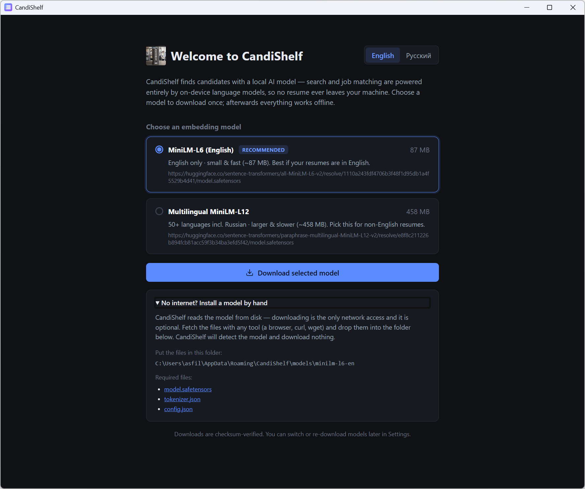
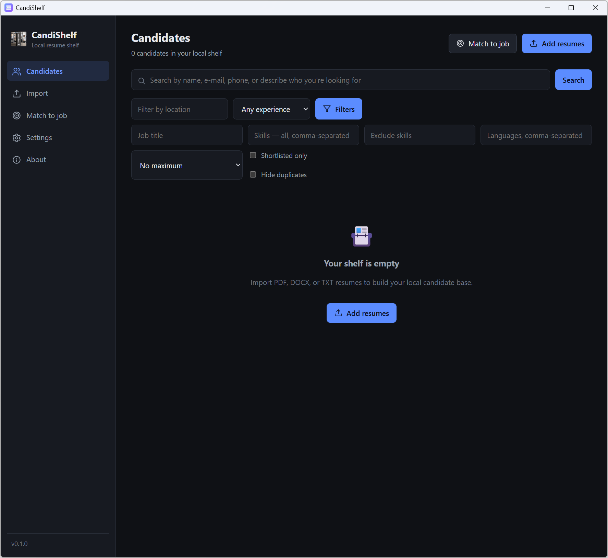

# CandiShelf — User Manual

**English** · [Русский](README.ru.md)

A compact guide to every screen and menu item. For installation, the product
overview, and AI-model details, see the [main README](../README.md).

<!-- Add English screenshots under manual/screenshots/en/. Each image below points
to a file there; drop in the PNG with the matching name and it will appear
automatically. The Russian guide uses the same file names under
manual/screenshots/ru/. -->

The left sidebar has five items — **Candidates**, **Import**, **Match to job**,
**Settings**, and **About**. The app version sits at the bottom of the sidebar
(click it to open About). On the very first launch a **Welcome** screen appears
before the sidebar.

---

## 1. Welcome (first run)

Shown once, until an AI model is active. Everything runs on-device; only the
model download touches the network.

- **Language** toggle (English / Русский) in the top-right corner.
- **Choose an embedding model** — pick one of the offered local models; the
  recommended one is preselected. Each shows its languages and size.
- **Download selected model** — downloads and checksum-verifies the model, then
  activates it. If the files are already on disk, the button reads **Use selected
  model** and nothing is downloaded.
- **No internet? Install a model by hand** — expander with the exact folder and
  the three files to place manually.
- You do this only once; afterwards the app opens on **Candidates**.

<!-- Screenshot: first run -->

## 2. Candidates

The home screen: your searchable shelf, filters, the shortlist, and CSV export.

### Header

- Candidate count and shortlisted count.
- **Export shortlist** — appears when at least one candidate is shortlisted;
  writes a CSV and shows where it was saved.
- **Match to job** — opens **Match to job**.
- **Add resumes** — opens **Import**.

### Search

- Describe who you need in plain language (e.g. "DevOps engineer with fintech
  experience") to rank candidates by meaning, **or** type an exact identifier:
  a full e-mail, phone number, or LinkedIn URL, or a name (words in any order).
- Exact matches appear **above** semantic ones; each result shows *how* it
  matched — **Exact e-mail / phone / LinkedIn**, **Name**, or **Semantic** — plus
  a snippet from the CV.
- Press **Enter** or click **Search**. Clear the box (and search) to return to the
  full list.

### Filters

- Always visible: **location**, **min experience**, and the **Filters** button.
- Behind **Filters**: **job title**, **skills (all, comma-separated)**,
  **exclude skills**, **languages**, **max experience**, **Shortlisted only**,
  and **Hide duplicates**. The button shows the active filter count;
  **Clear filters** resets everything.
- Filters apply to both the plain list and the search results.

### List & results

- Click a row to open the **candidate card**.
- The ★ button adds or removes the candidate from the shortlist.
- A **Duplicate** badge flags resumes likely from the same person (shared e-mail,
  phone, or LinkedIn).

<!-- Screenshot: candidates list -->

<!-- Screenshot: expanded filters -->

## 3. Candidate card

Opens over the list when you click a candidate. It shows the parsed profile and
the full extracted text.

- **Contact** — e-mail (click to open your mail app), phone, LinkedIn, location,
  experience.
- **Skills / Languages / Education** as chips, and **Experience** (work history)
  as entries.
- **Source file** and the **Extracted text**.
- Buttons:
  - **Open original** — opens the source resume in your default application.
  - **Edit** — edit fields and lists inline, then **Save changes** (or Cancel).
  - **Re-process** — re-runs extraction and parsing from the original file
    (useful if a field looks wrong).
  - **Delete** — permanently removes the profile, text, embeddings, and any
    copied original; asks for confirmation.
  - ★ (top-right) — toggle the shortlist.
- A warning at the top flags a **possible duplicate** and names the other
  candidate(s).

<!-- Screenshot: candidate card -->

## 4. Import

Add PDF, DOCX, or TXT resumes to your shelf.

- **Drag & drop** files into the drop zone, **Choose files**, or **Choose
  folder** (recurses through a folder).
- Processing is local; a progress bar shows the current file.
- When it finishes: **Documents found / Successfully processed / Failed**, with a
  per-file error list for failures — one bad file never stops the batch.
- **View candidates** returns to **Candidates**.
- Tip: enable **Copy original resume files…** in Settings so originals stay
  available if you later move them.

<!-- Screenshot: import -->

## 5. Match to job

Rank candidates against a vacancy.

- Paste the vacancy text (or click **Use sample vacancy**), then **Find matching
  candidates**.
- **Detected requirements** — the requirements parsed from the text.
- **Ranked candidates** — each result shows a score, ✓ matched and ✗ missing
  requirements, and a supporting snippet. Click a row to open the candidate card.
- Results are a recommendation for you to review; CandiShelf never decides
  automatically.

<!-- Screenshot: match -->

## 6. Settings

- **Language** — switch the interface between English and Русский; the choice is
  remembered.
- **Data directory** — where the database, embeddings, models, and settings live;
  **Change** it to move storage. **Copy original resume files…** keeps copies of
  imported resumes.
- **AI models** — the active local model powers search and job matching:
  - **Download** installs a model (it becomes active).
  - **Use** switches the active model; **Re-download** and **Remove** manage
    installed ones.
  - Switching a model **re-embeds** your existing candidates (with progress) so
    they stay searchable in the new model's space.
  - The **No internet? Install a model by hand** expander shows the target folder
    and files.
- **Updates & status** — current version and **Check for updates** (new versions
  are published on GitHub Releases).
- **Danger zone** — **Clear database** permanently deletes all candidates, text,
  and embeddings (models are kept); it asks for confirmation.

<!-- Screenshot: settings -->

<!-- Screenshot: AI models -->

## 7. About

- App name, version, build, author (link), homepage, and license.
- **Privacy & security** — everything runs locally; file contents are only read
  as text; downloads are checksum-verified.
- **Data** — where your database and models are stored.

<!-- Screenshot: about -->

---

## Quick tips

- **Enter** in the search box runs the search.
- Click the version at the bottom of the sidebar to jump to **About**.
- Everything works offline after the one-time model download.
- CandiShelf is a candidate shelf, not an ATS: it recommends, you decide.
