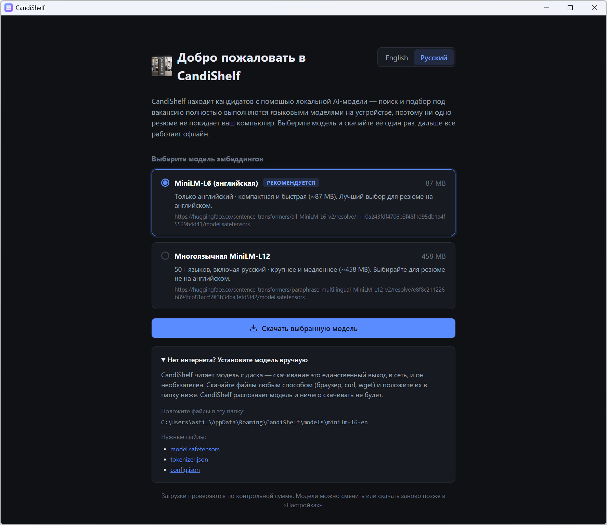
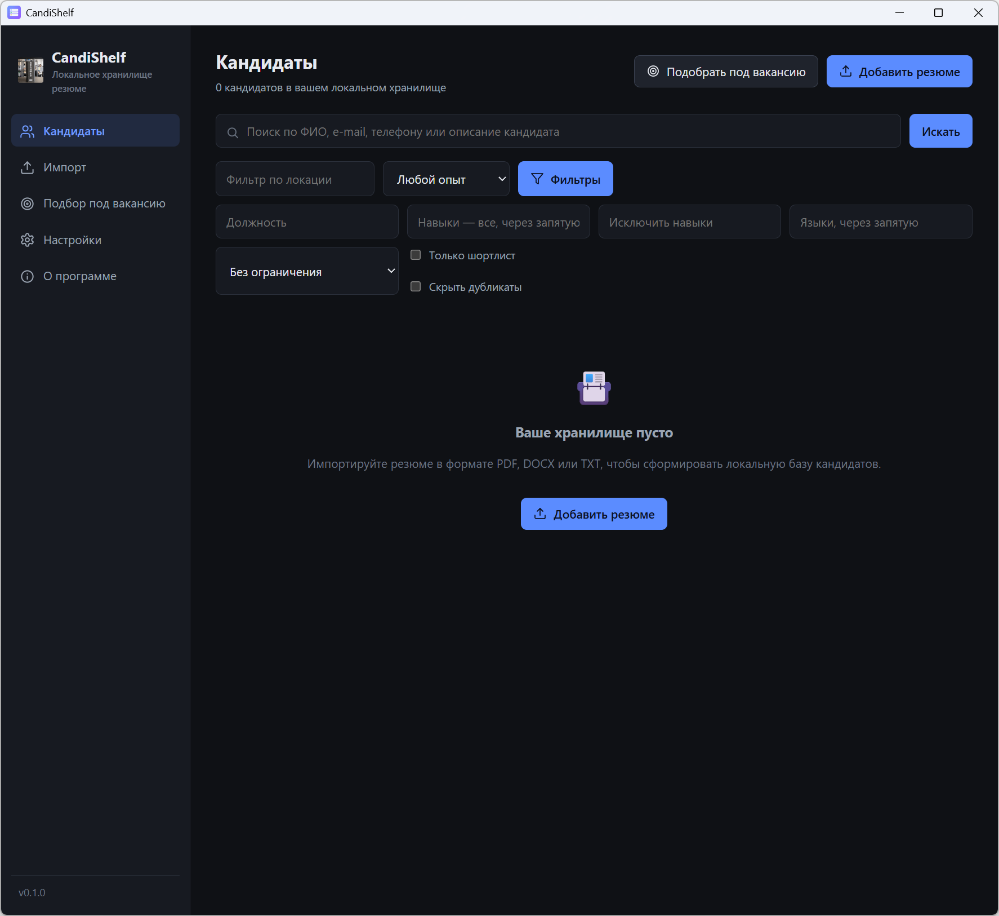
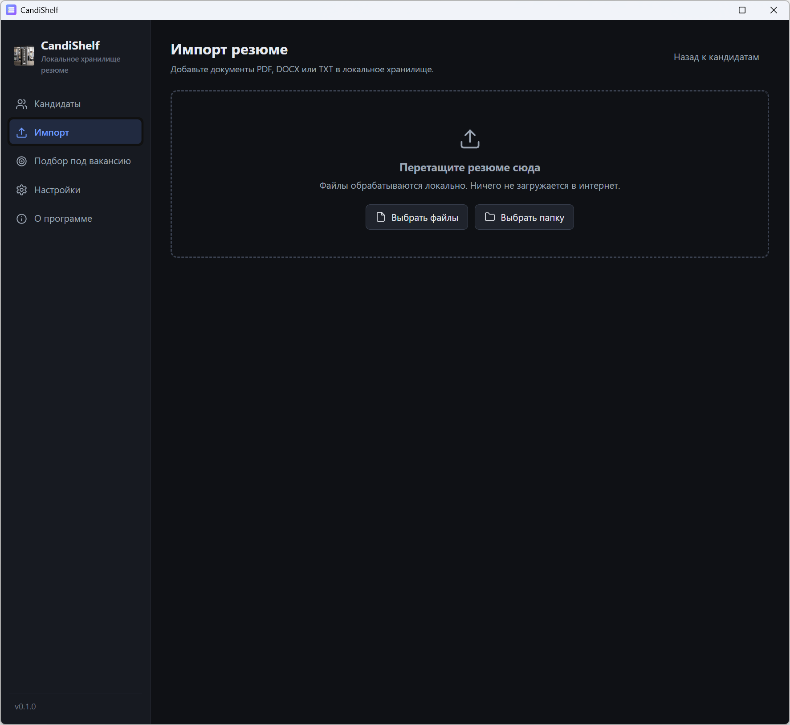
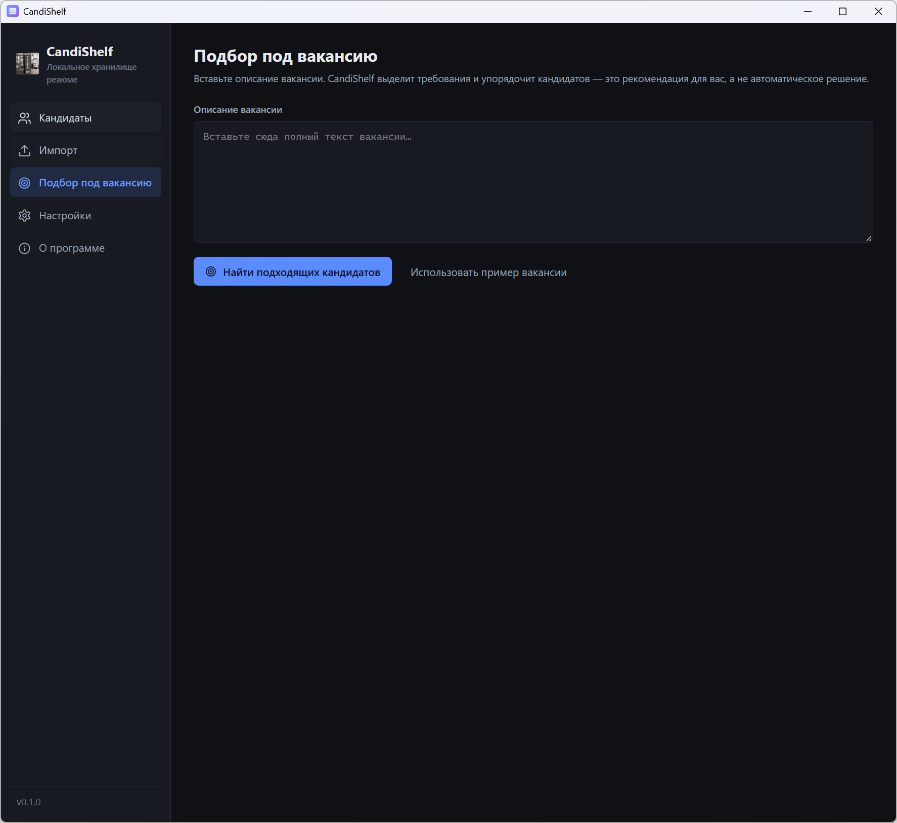
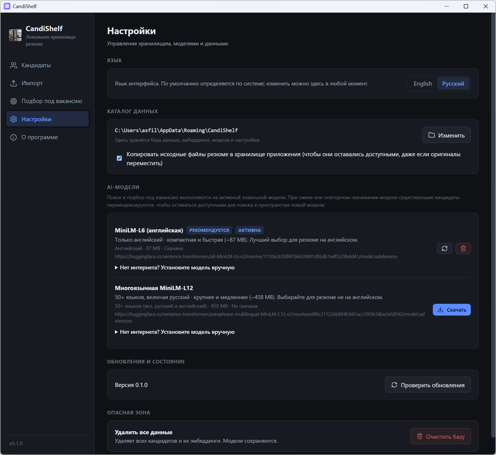
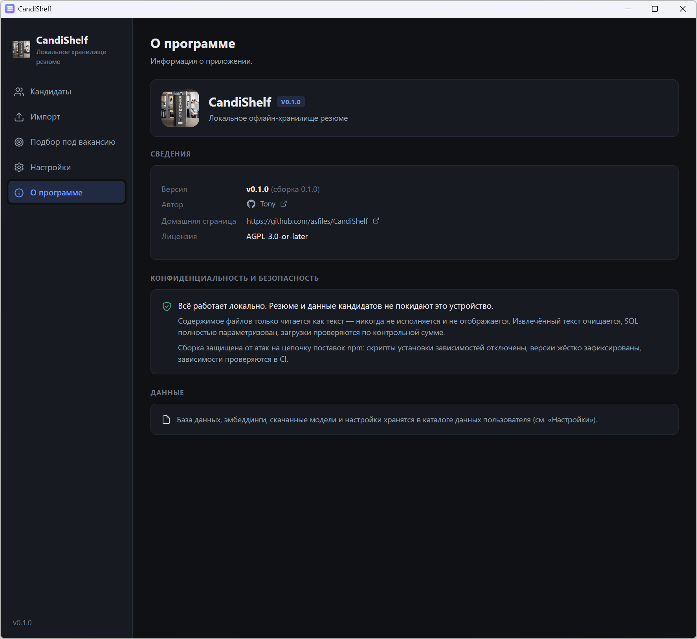

# CandiShelf — Руководство пользователя

[English](README.md) · **Русский**

Компактный гид по каждому экрану и пункту меню. Установка, обзор продукта и
подробности о AI-моделях — в [основном README](../README.ru.md).

<!-- Добавьте русские скриншоты в manual/screenshots/ru/. Каждое изображение ниже
ссылается на файл там; положите PNG с нужным именем — и он появится
автоматически. Английское руководство использует те же имена файлов в
manual/screenshots/en/. -->

В левом меню пять пунктов — **Кандидаты**, **Импорт**, **Подбор под вакансию**,
**Настройки** и **О программе**. Версия приложения — внизу сайдбара (нажмите,
чтобы открыть «О программе»). При самом первом запуске перед появлением сайдбара
открывается экран **«Добро пожаловать»**.

---

## 1. Добро пожаловать (первый запуск)

Показывается один раз, пока не активна AI-модель. Всё работает на устройстве;
сеть нужна только для скачивания модели.

- Переключатель **языка** (English / Русский) в правом верхнем углу.
- **Выберите модель эмбеддингов** — выберите одну из доступных локальных
  моделей; рекомендуемая уже отмечена. Для каждой указаны языки и размер.
- **Скачать выбранную модель** — скачивает и проверяет модель по контрольной
  сумме, затем активирует её. Если файлы уже на диске, кнопка называется
  **«Использовать выбранную модель»**, и ничего не скачивается.
- **«Нет интернета? Установите модель вручную»** — раскрывающийся блок с точной
  папкой и тремя файлами для ручной установки.
- Это делается один раз; дальше приложение открывается на экране **«Кандидаты»**.

<!-- Скриншот: первый запуск -->

## 2. Кандидаты

Главный экран: база для поиска, фильтры, шортлист и экспорт в CSV.

### Шапка

- Число кандидатов и число в шортлисте.
- **Экспорт шортлиста** — появляется, когда в шортлисте есть хотя бы один
  кандидат; сохраняет CSV и показывает путь.
- **Подобрать под вакансию** — открывает экран подбора.
- **Добавить резюме** — открывает экран импорта.

### Поиск

- Опишите, кто нужен, обычными словами (например, «DevOps-инженер с опытом в
  финтехе») — кандидаты ранжируются по смыслу, **или** введите точный
  идентификатор: полный e-mail, телефон или ссылку на LinkedIn, либо ФИО (слова в
  любом порядке).
- Точные совпадения идут **выше** смысловых; в каждом результате видно, *как* он
  совпал — **точное совпадение по e-mail / телефону / LinkedIn**, **по ФИО** или
  **смысловое**, — и фрагмент из резюме.
- Нажмите **Enter** или **«Искать»**. Очистите поле (и выполните поиск), чтобы
  вернуться к полному списку.

### Фильтры

- Всегда видны: **локация**, **минимальный опыт**, кнопка **«Фильтры»**.
- За кнопкой **«Фильтры»**: **должность**, **навыки (все, через запятую)**,
  **исключить навыки**, **языки**, **максимальный опыт**, **«Только шортлист»** и
  **«Скрыть дубликаты»**. На кнопке отображается число активных фильтров;
  **«Сбросить фильтры»** очищает всё.
- Фильтры применяются и к списку, и к результатам поиска.

### Список и результаты

- Нажмите на строку, чтобы открыть **карточку кандидата**.
- Кнопка ★ добавляет кандидата в шортлист или убирает его.
- Значок **«Дубликат»** отмечает резюме, вероятно принадлежащие одному человеку
  (совпадают e-mail, телефон или LinkedIn).

<!-- Скриншот: список кандидатов -->

## 3. Карточка кандидата

Открывается поверх списка при клике на кандидата. Показывает разобранный профиль
и полный извлечённый текст.

- **Контакты** — e-mail (клик открывает почтовое приложение), телефон, LinkedIn,
  локация, опыт.
- **Навыки / Языки / Образование** в виде чипов и **опыт работы** в виде записей.
- **Исходный файл** и **извлечённый текст**.
- Кнопки:
  - **Открыть оригинал** — открывает исходное резюме в приложении по умолчанию.
  - **Редактировать** — правка полей и списков, затем **«Сохранить изменения»**
    (или «Отмена»).
  - **Обработать заново** — повторно извлекает и разбирает данные из оригинала
    (полезно, если поле выглядит неверно).
  - **Удалить** — безвозвратно удаляет профиль, текст, эмбеддинги и
    скопированный оригинал; запрашивает подтверждение.
  - ★ (справа вверху) — переключить шортлист.
- Предупреждение вверху отмечает **возможный дубликат** и указывает другого
  кандидата.

## 4. Импорт

Добавление резюме в форматах PDF, DOCX или TXT.

- **Перетащите** файлы в зону загрузки, **«Выбрать файлы»** или **«Выбрать
  папку»** (с обходом вложенных папок).
- Обработка идёт локально; прогресс-бар показывает текущий файл.
- По завершении: **Найдено документов / Успешно обработано / С ошибками**, со
  списком ошибок по файлам — ошибка одного файла не останавливает остальные.
- **«Показать кандидатов»** возвращает на экран **«Кандидаты»**.
- Совет: включите **«Копировать исходные файлы резюме…»** в настройках, чтобы
  оригиналы оставались доступными при их перемещении.

<!-- Скриншот: импорт -->

## 5. Подбор под вакансию

Ранжирование кандидатов под вакансию.

- Вставьте текст вакансии (или нажмите **«Использовать пример вакансии»**), затем
  **«Найти подходящих кандидатов»**.
- **Найденные требования** — требования, выделенные из текста.
- **Кандидаты по релевантности** — у каждого результата оценка, ✓ совпавшие и
  ✗ ненайденные требования и подтверждающий фрагмент. Клик по строке открывает
  карточку кандидата.
- Это рекомендация для вас; CandiShelf ничего не решает автоматически.

<!-- Скриншот: подбор под вакансию -->

## 6. Настройки

- **Язык** — переключение интерфейса между English и Русский; выбор сохраняется.
- **Каталог данных** — где хранятся база, эмбеддинги, модели и настройки;
  **«Изменить»** переносит хранилище. Флажок **«Копировать исходные файлы
  резюме…»** хранит копии импортированных резюме.
- **AI-модели** — поиск и подбор выполняются на активной локальной модели:
  - **«Скачать»** устанавливает модель (она становится активной).
  - **«Использовать»** делает модель активной; **«Перекачать»** и **«Удалить»**
    управляют установленными моделями.
  - При смене модели существующие кандидаты **переиндексируются** (с прогрессом),
    чтобы оставаться доступными для поиска в пространстве новой модели.
  - Блок **«Нет интернета? Установите модель вручную»** показывает целевую папку
    и файлы.
- **Обновления и состояние** — текущая версия и **«Проверить обновления»** (новые
  версии публикуются в GitHub Releases).
- **Опасная зона** — **«Очистить базу»** безвозвратно удаляет всех кандидатов,
  текст и эмбеддинги (модели сохраняются); запрашивает подтверждение.

<!-- Скриншот: настройки -->

## 7. О программе

- Название приложения, версия, сборка, автор (ссылка), домашняя страница и
  лицензия.
- **Конфиденциальность и безопасность** — всё работает локально; содержимое
  файлов только читается как текст; загрузки проверяются по контрольной сумме.
- **Данные** — где хранятся база и модели.

<!-- Скриншот: о программе -->

---

## Краткие советы

- **Enter** в поле поиска запускает поиск.
- Клик по версии внизу сайдбара открывает **«О программе»**.
- После однократного скачивания модели всё работает офлайн.
- CandiShelf — это «полка кандидатов», а не ATS: приложение рекомендует, решаете
  вы.
